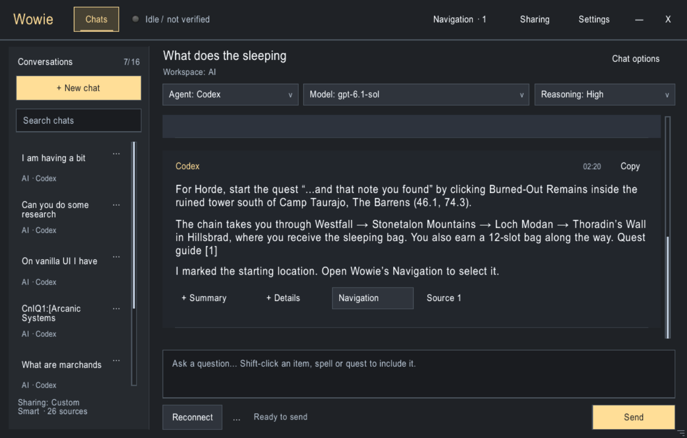

# Wowie

**An in-game AI chat assistant for World of Warcraft: Forever.**

Ask questions about your character, items, spells, professions or quests without leaving the game. Wowie connects an addon chat window to an AI CLI on your computer. Choose a sharing preset once; the assistant can then request the relevant permitted information itself.

> **A chat companion, not an autopilot.** Wowie is intended for conversation, explanations and read-only character context—not botting, unattended play or gaining an unfair advantage. You remain in control of your character and every gameplay action.

Wowie is an independently maintained fork with its own interface and workflow. It builds on the original project's chat and bridge foundation; see [Credits](#credits) for attribution.

## Interface

<p align="center">
  
</p>

## Purpose and boundaries

**The assistant reads character information; it does not control your character.** The addon's information-query channel exposes permission-gated data readers, not arbitrary Lua execution or gameplay commands.

- **No automated gameplay:** the addon does not move your character, cast spells, execute combat rotations, gather resources, trade or complete quests for you.
- **No injected game code or game-memory inspection:** communication uses addon-visible pixels and ordinary addon files, not a process hook or generated keyboard/mouse input.
- **No privileged game knowledge:** queries are limited to what the client's addon APIs and permitted addon data expose. Restricted, unavailable and unsupported values are reported as such.
- **Visible UI conveniences, not character control:** map annotations and waypoint tracking update your map UI. Optional macro buttons save a draft only when you click them; Wowie does not execute the macro.

Local AI CLIs have their own computer-side permissions, separate from character sharing; see [Agent permissions](#agent-permissions). The read-only information channel is not a sandbox for those tools.

This intended use is not a guarantee that a particular server permits external AI tools. Wowie is unofficial and makes no claim of server approval or ban immunity.

## The Wowie experience

- **Readable chat workspace:** opaque dark surfaces, a collapsible conversation sidebar, structured selectable replies, compact sources and persistent per-chat drafts.
- **Agent, model and reasoning controls:** choose them in the discussion header, or save addon-wide defaults in **Settings**. Each conversation keeps its own session and overrides.
- **Simple character sharing:** one-click Recommended or Minimal presets, Smart on-demand reads, and optional customization. Includes action bars/keybinds, current interactions and optional Auctionator prices; private/social data and macro bodies remain opt-in.
- **Integrated navigation:** search saved destinations, add or delete points, show them on the map and manage route stops from **Navigation**, without typing layer names.
- **Bridge verification and recovery:** fresh round-trip checks, delivery acknowledgements, persistent transcripts and clearer idle/error states.
- **Less intrusive transport options:** **Robust**, **Compact** and **Quiet** pixel displays, with calibration before a smaller or dark display is enabled.

Supported agents are **Claude Code**, **OpenAI Codex**, **Grok Build**, **Antigravity CLI** and **Hermes Agent**. Model and reasoning options depend on the selected CLI and its capabilities. Installation, authentication and provider-specific limits are documented in [Agents](docs/AGENTS.md).

## Getting started

### Requirements

- **World of Warcraft: Forever**, windowed or borderless. Tested builds include 1.60.1.69913 and 1.60.1.69977, TOC 16001; compatibility with other clients is not implied.
- **Node.js 22.2 or newer**.
- At least one supported AI CLI, installed and authenticated on the bridge computer. Its normal provider/account requirements still apply.
- A supported capture environment:
  - **Windows:** NTFS.
  - **Linux:** Python 3 and Wine/Proton on **X11 or a compatible Wayland compositor**. Direct Wayland capture uses Python's standard library and libwayland-client, with no source picker or portal fallback. Hyprland is tested-capable; not every compositor exposes the required protocols. Native Wine Wayland and Xwayland windows are supported. See [Linux setup](docs/INSTALL-LINUX.md).
  - **macOS:** Python 3 and a native game client, with Automation and Screen Recording permission for the terminal running the bridge.

The bridge runs locally; the selected AI CLI may send prompts to an external provider. “Local bridge” does not mean “local model.”

### Install and launch

1. **Fully quit WoW before running setup.** This is especially important when migrating an existing installation so the client can save its latest data.
2. Clone this repository and install the addon:

   ```sh
   git clone https://github.com/ligmaSec/wowie
   cd wowie
   node setup.js --project "<folder for the AI CLI to work in>"
   ```

   Setup finds the client automatically where possible. If necessary, add `--wow "<client folder>"`, pointing at the folder containing `Interface` and `WTF`, such as `_forever_`.

   The installer copies **Wowie**, writes `bridge/config.json` and generates its load-on-demand reply slots and signal files. Thousands of tiny generated files are expected: the client must discover them at launch.

3. Launch WoW and enable **Wowie** and its generated slot addons at character selection.
4. Start the bridge from the repository:

   ```sh
   npm start
   ```

   Keep that terminal open while using Wowie. The supervisor restarts a crashed bridge; **Ctrl+C** stops it. Windows also has `bridge\start.ps1` and `bridge\start-window.cmd`.

5. Open **`/wowie`**, choose your agent, review **Sharing**, then send a question. **Reconnect** checks the bridge without asking the AI anything.

Platform walkthroughs: [Windows](docs/INSTALL-WINDOWS.md) · [Linux / Wine / Proton](docs/INSTALL-LINUX.md). On macOS, setup checks `/Applications/World of Warcraft` and `~/Applications/World of Warcraft`; grant the requested capture permissions on first use.

The `--project` folder is the AI CLI's working directory, not an extra source of in-game character data. Choose it with the CLI's host permissions in mind.

### Updating or migrating an existing installation

Let active agent jobs finish, stop the bridge, and **fully quit WoW**. Update this checkout, then run:

```sh
node setup.js
```

The installer carries forward account data, chats, settings, pending request identities, local map edits, generated sounds, addon-enable choices and hotkey targets. Existing Wowie data is not overwritten; previous saved files and cache backups are retained for recovery. Obsolete addon/slot folders are removed only after installation succeeds.

Relaunch the game and start the bridge again. **`/reload` cannot discover renamed or newly added addon files.** For later Lua-only updates, deploy the files and use `/reload`; restart the bridge after bridge changes when it is idle.

The interface revamp adds `ReplyView.lua`. Install the update, then **fully quit and relaunch WoW once** so the client discovers it. Restart the bridge when idle to use the updated reply-format instructions.

If you used a previous global launcher, unlink that command and run `npm link` from this repository. The current launcher is **`wowie`**; `wowie --project <folder>` selects a working folder explicitly. Otherwise, `wowie` uses the folder it is launched from, while `npm start` in this repository falls back to the configured `defaultCwd`. Run only one bridge at a time.

## Using Wowie

Open `/wowie` and use **New chat** in the Conversations sidebar. Each chat has a persistent agent session, transcript, working folder and draft. Its **...** menu provides rename, copy, folder, fresh-session, clear and delete actions.

**Chats** toggles the sidebar when you want more reading space. The wider sidebar uses compact rows with single-line titles, a separate metadata line and an aligned actions column. Hover a title to read it in full; truncation never changes the saved name. Search and the sharing footer remain separate from the scrollable list.

Replies use gold section headings, highlighted **bold** terms, clearer section spacing and a bounded reading width. Bullets and numbered steps wrap beneath their text, not beneath their markers. Paragraphs, lists, quotes and code remain directly selectable; code retains the full available width.

Markdown links become highlighted inline **[1]** source references: hover to see the full URL, or click to open it for copying because an addon cannot launch your browser. Routine bridge **Details** stay collapsed; errors remain visible. The per-message **Copy** button retains the original complete text, including Markdown, list markers and URLs.

Agents are instructed to lead with the answer, keep bullets to one point, and use short labeled sections for comparisons. Existing replies get the new presentation without rewriting saved history. Updating an existing `ReplyView.lua` installation needs `/reload`; restart the bridge to apply the new answer instructions.

**Settings → Reading** offers Small, Medium and Large text, plus a local **Preview formatting** page. **Back to Settings** preserves unsaved choices. Preview never sends an AI request or creates a conversation. Save applies reading preferences; Cancel discards them.

- **Agent / Model / Reasoning** apply to the next message. Changing agents starts a fresh agent session while keeping the transcript. Pending requests retain the settings they were sent with.
- **Settings** saves addon-wide defaults without editing the bridge configuration. Selection precedence is **per-chat choice → addon default for that agent → bridge config → CLI default**.
- **Enter** sends; **Shift+Enter** inserts a newline. Drag-select reply text and press **Ctrl+C** to copy it directly. **Esc** releases text focus without discarding your draft.
- **Shift-click** an item, spell, quest or chat link into the composer to include its name and tooltip in your question.
- **Stop waiting** stops local waiting, not the external AI process. **Check reply** retrieves an outstanding reply without consuming your next-message draft.
- Pending replies have animated activity dots, an elapsed timer and a distinct sending, queued, shared-context or working label. Search activity shows the actual query; browse actions show their URL or find target when the agent supplies it.

The full answer stays in the discussion window, without a separate generated summary or summary button. Game-chat echo defaults to a bounded preview of the answer with an **open** link; `/wowie echo full` prints more, and `/wowie echo off` disables the echo.

### Map annotations and navigation

When an answer recommends visiting a location, trainer, vendor or other in-game destination, the assistant also creates a saved navigation point—no separate map request is needed. It resolves the destination's map and coordinates rather than relying on prose alone. Manage those points through **Navigation**:

- **Navigate** starts a destination; that point's button becomes **Stop navigation**, so another click cancels guidance without deleting the point. **Previous**, **Next** and the active card's **Stop** remain available.
- **On map / Show on map** opens and centers the destination, using OpenMap's stitched-world view or the native map canvas. Wowie minimizes so it does not cover the map; your draft and active route are preserved.
- **Add point** saves your current position, a world-map pin or entered coordinates to **My places** or an existing route.
- **Delete** asks for confirmation; local edits persist through reloads and bridge refreshes.

Guidance uses native map/minimap waypoint tracking. With **ShortestPathForever** enabled, its routing API can provide terrain-aware dotted paths. These are directions for you to follow, not automatic movement.

Optional **`Wowie_Nodes`** data provides known herb/ore spawn coordinates filtered by gathering skill. Neither those static points nor an AI-generated map mark proves that a resource is currently present. AI-supplied locations can be wrong.

See [Map and navigation](docs/MAP.md) for data sources, layers and optional command shortcuts.

### Macro drafts

An answer can include a **Create macro** or **Update macro** button. Clicking it saves the proposed macro and puts it on your cursor for manual placement. Replacing a different existing macro, or saving one containing `/run`, `/script` or `/click`, asks for confirmation.

No macro is saved in combat, and Wowie never runs it. Execution remains a normal player action through the game's macro system. `/wowie macro undo` restores the previous macro or removes one the button created.

### Useful commands

Most controls are available in the UI; commands are optional shortcuts.

| Command | Purpose |
|---|---|
| `/wowie` | Open or collapse the workspace; `/ai` and `/ask` are aliases |
| `/wowie <text>` | Send a question from the normal chat box |
| `/wowie new [name]` | Start a separate conversation |
| `/wowie agent <id>` | Select `claude`, `codex`, `grok`, `agy` or `hermes` |
| `/wowie cd <folder>` | Change the current chat's AI working folder |
| `/wowie context [on\|off]` | Show the selected summary or resume/pause character sharing |
| `/wowie copy` | Open the whole-reply copy box |
| `/wowie diag`, `/wowie slots` | Inspect transport and reply-slot status |
| `/wowie help` | Show the full command list |

## Sharing and privacy

Open **Sharing**, choose **Recommended**, and ask your question. There is no separate Save step and no need to enable individual API namespaces for built-in character information. Existing explicit choices survive updates; applying a preset deliberately replaces them.

- **Recommended** allows useful ordinary character data: gear, bags, spells, skills, talents, quests, action bars/keybinds, auras, pet state, reputation, currencies, collections, combat stats, current interactions, travel, cached lockouts and optional Auctionator data.
- **Minimal** allows only identity and location.
- **Smart delivery** is the default. Each question carries small enabled essentials plus a catalog of permitted sources. The AI fetches relevant details automatically through read-only queries, rather than collecting everything or asking you to hunt for another checkbox.
- **Customize** opens the searchable per-category controls, private/social permissions and advanced API scopes. **Full snapshot** delivery is available there if you want all selected snapshot data with every question; Auctionator databases and advanced APIs still remain query-only.
- **Sharing on / paused** blocks or resumes reads without erasing your choices. Delivery and permission settings are independent.

**Action bars** include assigned spells/items/macros/flyouts, observed button/page mappings, keybinds, counts, cooldowns and charges where exposed. Native and installed EllesmereUI button mappings are read without pressing or changing them. Macro names can be shown with actions, but **macro bodies** require their separate private permission.

**Auctionator** is optional and detected automatically. Wowie reads recognized cached prices and history from the active database, including the installed version's `Auctionator.Database.db` / `AUCTIONATOR_PRICE_DATABASE` and supported `AuctionatorDB` price layouts. No full database is attached to every message; targeted item queries and bounded pages provide the details. Prices are historical observations in copper, not live listings or proof of current stock. Wowie never starts scans, bids, buys or posts.

The assistant can also read currently open merchant/trainer/gossip/quest windows, bind location and visible taxi options, cached instance lockouts, gear durability, temporary weapon enchants and repair costs where exposed. Closed windows and missing APIs are reported explicitly.

Bank, mail, chat history, guild, friends/Battle.net, party/raid, target/focus, macro bodies, UI/addon tables and advanced API access remain separate private/broad permissions. Broad API/UI/addon scopes can overlap categories; their descriptions explain this. **Mail bodies require separate consent because the client's read API marks messages as read.** Additional queries always check current consent.

Pausing or changing sharing cannot recall information already sent. Links you manually include in a message still share their tooltip.

Prompts and permitted character data can reach the selected AI provider. Chat history and bridge state are also persisted locally for recovery. The private `bridge/requests.json` journal holds active shared snapshots/query continuations and retained full results; active snapshot payloads are removed at completion or deletion. Do not treat the Sharing panel as an anonymity mechanism or a way to remove data from a provider after delivery.

Only approved native data getters and permitted raw data are exposed through character queries. Arbitrary Lua, setters, mail sending/deletion and protected gameplay commands are not query operations. Closed-window, secret or restricted values are returned as unavailable.

### Agent permissions

The external AI CLIs are general-purpose tools. Depending on their own configuration, they can read or edit files and run commands in their working folder. **Character-sharing checkboxes do not restrict those host tools.**

Review `agents.<id>` in `bridge/config.json`, including the permission mode, tool rules and provider-specific sandbox options. Use a CLI's read-only/planning mode where supported if you want host-side work to be read-only too; the default configuration must not be assumed to enforce that.

For Claude and Grok, **Allow & retry** can permanently add displayed tool rules to the configuration. That is computer-side authorization, not a gameplay permission. See [Agents](docs/AGENTS.md) and [Configuration](docs/CONFIGURATION.md) for the exact behavior of each CLI.

## How communication works

WoW addons cannot open a normal network connection or freely write files. Wowie uses two channels:

1. **Out of the game:** the addon encodes requests in a checked pixel strip. The bridge captures and decodes that strip, then runs the selected CLI.
2. **Into the game:** the bridge writes ordinary files in pre-created load-on-demand slot addons. WoW loads a fresh slot to receive replies, progress, context queries and map annotations.

Sound-file readiness checks are notification hints, not proof of a live connection. **Reconnect** requires a fresh matching challenge/acknowledgement round trip. The UI reports verification age rather than pretending there is a persistent socket.

Completed replies survive bridge restarts and can be replayed without running the agent again. Queued requests and addon-information waits resume from their saved state. If the bridge stops during agent execution, Wowie reports an interrupted request instead of silently repeating potentially side-effecting work; inspect the result before explicitly sending a new question.

Request protocol 2 adds durable reply/restore receipts and chat generations, so stale work cannot resurrect a deleted conversation. Update both halves together: run setup, restart the idle bridge, then `/reload` an existing addon installation. Preserve `bridge/requests.json`, `state.json` and `transcripts.json` when troubleshooting.

Under **Settings → Pixel display**, Compact uses smaller cells where the display supports them. Quiet uses dark colors and verifies whether a smaller or larger dark grid is reliable. Failed calibration keeps the robust display. These options reduce visual intrusion; they do not change the assistant's permissions.

Pixel textures are built and repainted in bounded slices across UI frames, with an approximately 2 ms paint budget when the client's profiler is available. Only complete frames are shown, and each gets its full capture interval after painting. Large uploads or low frame rates can therefore take more frames without dropping selected information or doing the entire canvas update in one game frame.

Normal pixel-mode exchanges do not require a reload per message. The reply pool is still finite: **200 slots per UI session**, freed by `/reload`, not by restarting Node. A reload-based fallback exists for setups where capture is unavailable.

Protocol details and limitations: [Architecture](docs/ARCHITECTURE.md).

## Troubleshooting

- **Bridge not responding:** start the bridge, ensure the game window is capturable, then click **Reconnect**. A failed check keeps your draft.
- **Idle / not verified:** the previous verification expired; this is not proof that the bridge stopped. Sending checks again automatically.
- **Replies stop after extended use:** inspect `/wowie slots`. If exhausted, `/reload` frees the pool.
- **Request interrupted by restart:** the previous agent may have performed external work. Wowie will not automatically rerun that instruction; check the outcome before sending it again.
- **Another bridge owns this installation:** close the duplicate launcher. Ownership stays held until existing child processes are cleaned up; an occupied lock port fails closed rather than allowing duplicate execution.
- **A question takes a long time:** keep **Smart** delivery enabled so unused sources are not collected with every question. Full snapshots and large requested sections still increase prompt size; a faster model or lower reasoning level can reduce AI processing time. Compression does not reduce model tokens.
- **Linux capture is black, stale or cannot find the game:** follow the [Linux capture guide](docs/INSTALL-LINUX.md). `npm run probe` captures a diagnostic image; avoid sharing it if it contains private information.
- **New addon files or slots are missing:** run setup with the client closed, then fully relaunch—not just `/reload`.
- **An agent is missing or not authenticated:** check the bridge banner and run that CLI manually once. See [Agents](docs/AGENTS.md).
- **Saved chats disappeared:** the bridge keeps transcripts and can restore them on the next exchange. Preserve bridge data instead of deleting it as a connection fix.

## Documentation

- [Windows installation](docs/INSTALL-WINDOWS.md)
- [Linux / Wine / Proton installation](docs/INSTALL-LINUX.md)
- [Agents, authentication and host permissions](docs/AGENTS.md)
- [Configuration, flags and environment variables](docs/CONFIGURATION.md)
- [Architecture and transport](docs/ARCHITECTURE.md)
- [Map layers and navigation](docs/MAP.md)
- [Addon and macro API primer](docs/WOW-ADDON-PRIMER.md)
- [Contributing](CONTRIBUTING.md)
- [Changelog](CHANGELOG.md)

## Development

```sh
npm install
npm test
```

Source lives in `addon/Wowie/` and `bridge/`; isolated checks live in `tests/`. The optional `npm run test:live` makes a real AI request and is not part of the normal suite. See [Contributing](CONTRIBUTING.md) for the repository layout and test conventions.

## Credits

- [chelinho139's original project](https://github.com/chelinho139/wow-ai) — the upstream foundation from which Wowie was forked.
- [0xInuarashi's wow-forever-codex](https://github.com/0xinuarashi/wow-forever-codex) — investigation of Forever's file-loading behavior and the pixel-out channel.
- [Gethe/wow-ui-source](https://github.com/Gethe/wow-ui-source) — client UI/API reference.
- [Questie](https://github.com/Questie/Questie) and [QuestieDB](https://github.com/Questie/QuestieDB) — documentation of Forever's map behavior.

## License

MIT — see [LICENSE](LICENSE). Original attribution and license notices are retained.
